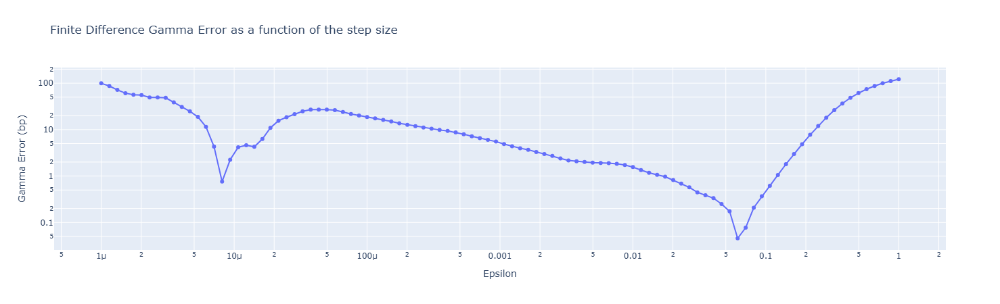
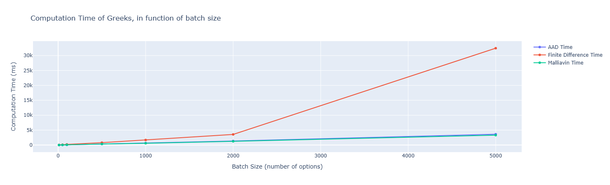
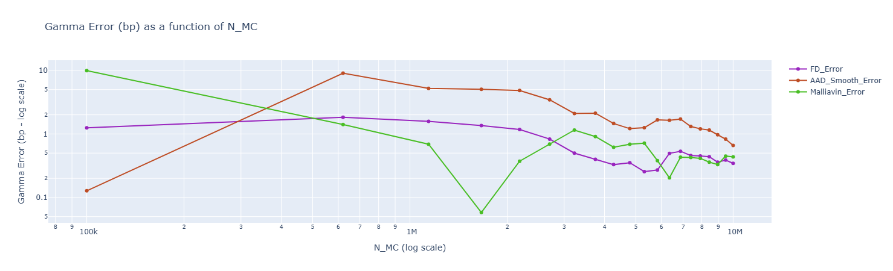

# Greeks Computation Benchmark: FD vs. AAD vs. Malliavin

## Summary

This project benchmarks three advanced numerical methods for computing Option Greeks (sensitivities), with a specific focus on the **Gamma ($\Gamma$)** of Digital and Vanilla options. It investigates the trade-offs between **Finite Differences (FD)**, **Pathwise Derivatives (AAD)** via PyTorch, and the **Likelihood Ratio Method (Malliavin Calculus)**.

Key results:
- Scalability: AAD and Malliavin offer superior scalability for large portfolios (O(1) complexity), achieving a 7x speedup compared to Finite Differences (O(N) complexity).
- Bias-Variance Trade-off: While Malliavin is the only statistically unbiased estimator (< 0.1 bp error), it suffers from higher variance than AAD.
- Operational Risk: Finite Differences hit a "Bias Floor" and require careful tuning of the bump size, making them operationally fragile for second-order Greeks.

## Methodology

The project considers the **Black-Scholes framework** under the risk-neutral measure $\mathbb{Q}$:

$$ \frac{dS_t}{S_t} = r dt + \sigma dW_t $$

Our objective is to compute the second-order sensitivity (Gamma) of the option price:
$$\Gamma = \frac{\partial^2 V}{\partial S_0^2} = \frac{\partial^2}{\partial S_0^2} \mathbb{E}^{\mathbb{Q}}[e^{-rT} \Phi(S_T)]$$

### Methods Evaluated

1.  **Finite Differences (FD):**
    *   *Method:* Approximates derivatives with Taylor expansion ($\Gamma = \frac{V(S+\epsilon) - 2V(S) + V(S-\epsilon)}{\epsilon^2}$).
    *   *Challenge:* Highly sensitive to the step size $\epsilon$ because of this $\frac{1}{\epsilon^2}$ term (Bias-Variance trade-off).

2.  **Pathwise Derivatives (AAD):**
    *   *Method:* Differentiates the payoff function directly inside the expectation ($\mathbb{E}[\Phi'(S_T) \frac{\partial S_T}{\partial S_0}]$).
    *   *Challenge:* Fails for discontinuous payoffs (e.g., Digital options $\Phi(S_T) = \mathbb{1}_{S_T > K}$) where the derivative is a Dirac delta. Requires **smoothing** (approximating Heaviside with Softplus).

3.  **Likelihood Ratio Method (Malliavin Calculus):**
    *   *Method:* Uses integration by parts to transfer the derivative from the payoff to the probability density function.
    *   *Advantage:* Handles discontinuities mathematically without smoothing bias.
    *   *Challenge:* Weights scale with $1/T$, leading to variance explosion at short maturities.

## Results & Performance
1. Numerical Stability

The Finite Difference method exhibits a characteristic "U-shape" error profile. The optimal step size is unstable and depends on the specific Greek and market regime, creating a significant implementation risk

2. Computational Efficiency

For large portfolios (Batch Size > 5000), **AAD and Malliavin are ~7x faster** than Finite Differences.

3. Accuracy & Bias

- **Finite Difference:** Hits a "Bias Floor". Increasing Monte Carlo simulations does not improve accuracy further due to the fixed
$\varepsilon$.

- **AAD (Unsmoothed):** Returns 0.0, confirming the failure of standard Pathwise estimators on zero-gradient regions (Heaviside).

- **AAD (Smoothed):** Converges stably but to a biased value (~2.18 bp error) due to the Softplus approximation.

- **Malliavin:** Statistically unbiased (< 0.1 bp mean error) but exhibits slower convergence due to the stochasticity of the weight ($Z^2$).

### Stress testing
**Regime Sensitivity:**
*Short Maturities* ($T < 0.1$): Malliavin estimators become unstable. Finite Difference requires re-calibration of
$\varepsilon$.

## Conclusion

This benchmark highlights that no single method is universally superior; the optimal choice depends on the specific payoff structure and market regime.

| Method | Pros | Cons | Best Use Case |
| :--- | :--- | :--- | :--- |
| **Finite Differences** | Simple to implement; Model-agnostic. | Slow (re-evaluation per Greek); Sensitive to step size $\varepsilon$ (Bias-Variance trade-off). | Black-box models or quick sanity checks. |
| **AAD (Pathwise)** | Extremely fast (O(1) Greeks); Exact for continuous payoffs. | Fails on discontinuities (e.g., Digital options, Barriers) unless smoothed. | Complex portfolios of continuous payoffs (e.g., Swaptions, Asians). |
| **Malliavin Calculus** | Handles discontinuities mathematically; Unbiased. | Higher variance; "Explodes" for short maturities ($1/T$ scaling). | Discontinuous payoffs with medium-to-long maturities. |

Next steps:
* **Variance Analysis**. Extensively test the Malliavinmethod for more sets of parameters (in moneyness and maturities) to precise the use case of this method.
* **Path-Dependent payoffs**. Extend the benchmark to more complex payoffs (e.g., Asian options, Barrier options)
* **Complex models**. The current implementation assumes constant volatility. The next logical step is to implement AAD for Model Calibration in a Heston framework.
